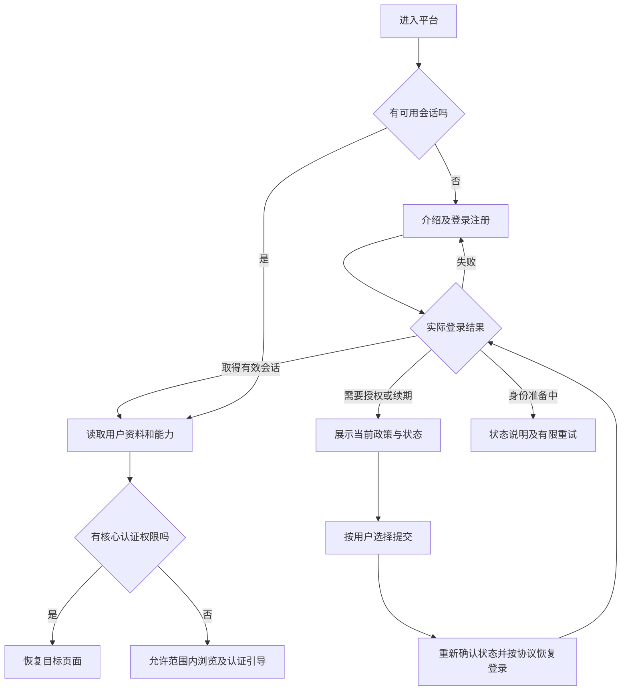
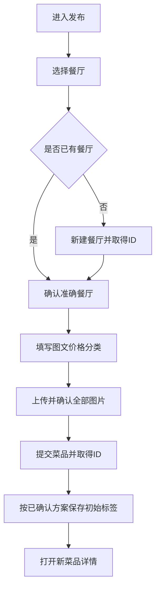

# 山软今天吃什么 · 产品需求文档

| 项目 | 内容 |
| --- | --- |
| 文档版本 | V1.0 |
| 更新日期 | 2026-10-22 |
| 文档用途 | 产品、设计、前端、后端及测试的需求基线 |
| 产品形态 | 移动端优先的响应式 Web/H5；管理后台优先适配桌面端 |
| 接口唯一依据 | `吃什么接口文档v2-openapi.yaml` |
| 接口版本 | `auth-renewal-20261019`，OpenAPI 3.1.0 |
| 接口规模 | 90 个路径、101 个操作、124 个模型 |
| 当前状态 | 需求定义完成；接口支持程度已静态核对，尚未进行服务端联调验收 |

> 本文中的“首版要求”是产品目标，不代表后端已经实现。每项需求均区分现有支持、需要明确约定和需要补充接口。旧版 JSON 导出不参与本 PRD。

## 1. 产品概述

### 1.1 产品定位

“山软今天吃什么”面向校园用户，提供美食发现、菜品分享、推荐和个人分类收藏服务。通过同学贡献的真实图片、描述、价格和就餐地点，帮助用户找到候选菜品，并在下次需要时快速找回。

产品的核心链路为：

**发现候选 → 查看菜品与餐厅 → 收藏并分类 → 实际体验后分享 → 再次选择。**

当前接口没有就餐确认或交易记录，产品不得把浏览、点赞、收藏统计为“已经吃过”，也不以此推断用户实际消费。

### 1.2 需要解决的问题

| 用户问题 | 产品提供的价值 | 对应功能 |
| --- | --- | --- |
| 每到饭点缺少选择，不知道有什么值得尝试 | 提供可浏览的候选与推荐 | 发现、餐厅浏览、今天吃什么 |
| 别人推荐过的东西容易忘记 | 保存具体菜品及其餐厅 | 收藏、浏览历史 |
| 收藏越来越多，临时想吃时难以查找 | 按个人习惯分类与检索 | 个人标签、收藏筛选 |
| 想分享一家店的一道菜，信息散在聊天中 | 形成可持续浏览的内容条目 | 图文发布、餐厅关联、公共标签 |
| 想知道校园同学的饮食体验 | 让贡献者、内容与互动建立联系 | 上传者信息、点赞、关注、专题动态 |

### 1.3 首版设计基线

以下为本 PRD 采用的产品默认值；与接口事实不同的地方会明确标注依赖：

1. 主体体验按移动端 Web/H5 设计，桌面端保留相同内容能力。
2. 普通菜品以“用户贡献、关联一家餐厅的菜品条目”呈现。它不是独立评分记录；同名条目的合并、纠错由管理规则处理。
3. 保留 v2 的身份门槛：核心菜品能力要求服务端授予 `verified`。未认证用户获得明确引导。
4. 普通菜品和餐厅的编辑、删除按现有管理员权限执行；作者自主管理作为增强需求，不在前端擅自放行。
5. 第一版推荐以展示服务端候选为主，不承诺预算筛选、个性化算法、绝不重复或营业状态准确性。
6. 个人标签按私人整理入口设计；后端必须在联调时明确其实际可见范围。
7. “年夜饭”按专题动态处理，暂不扩展成带成员、报名或费用结算的聚餐活动。

### 1.4 本期范围之外

以下不属于首版必需能力：下单支付、配送、商家入驻经营、评论回复、星级评分、公开收藏清单、关注内容流、自动生成饮食健康建议和根据消费记录打卡。它们如需进入排期，应另行定义数据来源、接口和验收标准。

## 2. 用户与典型场景

### 2.1 用户类型

| 用户 | 主要目标 | 产品行为 |
| --- | --- | --- |
| 首次访问者 | 了解平台，判断是否注册 | 查看本地介绍和登录入口；不请求受保护内容 |
| 已登录未认证用户 | 完善资料、完成认证、了解专题 | 查看账号状态、认证入口、允许访问的区域或动态 |
| 已认证用户 | 找吃的、记录喜欢的菜、分享体验 | 使用发现、推荐、收藏、标签、发布等核心功能 |
| 内容贡献者 | 让自己的分享被找到，管理已提交内容 | 查看我的菜品；按权限由管理员维护条目 |
| 管理员 | 维护地点、菜品、标签与账号秩序 | 管理列表、编辑删除、封禁解封、区域维护 |

“管理员”与“已认证”是否存在角色继承，由服务端确定。客户端不因用户是管理员就自行赋予全部认证能力。

### 2.2 典型用户故事

| 编号 | 用户故事 | 完成标志 |
| --- | --- | --- |
| US-01 | 作为已认证同学，我想先看一组候选，快速决定进一步了解哪道菜 | 能从推荐打开可用详情，看到价格、图片和餐厅 |
| US-02 | 我想找某家餐厅里大家分享的菜 | 能查询餐厅并进入店内菜品列表 |
| US-03 | 我收藏了很多菜，希望只看标为“想吃”的条目 | 服务端按标签返回全部匹配收藏，并正确分页 |
| US-04 | 我发现一道值得推荐的菜，希望上传图片和说明 | 发布关联准确餐厅，完成后可打开准确的新条目 |
| US-05 | 我不想授权设备定位，但想看选定区域的餐厅 | 手选区域后仍有明确、可用的查询路径 |
| US-06 | 我想关注一位同学并控制自己关注关系的可见性 | 关注结果正确，隐私设置可保存并实际生效 |
| US-07 | 作为管理员，我希望修改错误价格或删除失效条目 | 修改有明确结果，相关列表与详情刷新一致 |

## 3. 产品目标与衡量方式

首版以核心行为完成率和数据可信度为目标。当前没有运营基线，以下是指标定义，不是已达成的数据或对后端现状的描述。

| 指标 | 计算口径 | 用途 |
| --- | --- | --- |
| 推荐有效互动率 | 进入推荐页的会话中，发生菜品详情打开、收藏或点赞的会话占比 | 判断候选是否值得继续了解 |
| 找回收藏成功率 | 发起收藏查询后打开匹配条目的会话占比 | 判断分类整理是否有用 |
| 发布成功率 | 发起业务提交的次数中，确认成功创建条目的占比 | 检查发布流程稳定性 |
| 首次发布流失 | 发布页各步骤到下一步骤的转化 | 找出上传、餐厅选择或提交环节问题 |
| 认证完成率 | 进入认证引导后，服务端确认获得相应权限的用户占比 | 检查准入流程是否顺畅 |
| 7 日回访率 | 首次有效使用后 7 日内再次有效使用的用户占比 | 判断是否形成持续使用 |

埋点方式未在 v2 业务接口中定义，属于独立实施约定。首次试用形成基线后再设增长目标；上线前只验收事件口径和核心功能，不伪造运营指标。

## 4. 版本范围与需求状态

### 4.1 优先级

- **首版必需**：完成发现、发布、收藏整理所必需的能力，缺失时不能宣称对应核心体验完整。
- **首版增强**：可按接口准备情况进入首发；未准备好时隐藏入口或清楚限制，不提供无法执行的按钮。
- **后续**：不阻碍首版核心流程，另行排期。

### 4.2 交付阶段

| 阶段 | 可交付内容 | 边界 |
| --- | --- | --- |
| 契约内联调版本 | 账号与认证、餐厅内浏览、基础推荐、发布到已有餐厅、收藏列表、标签操作、资料和后台基础维护 | 发布后可返回列表，但尚不能保证精准跳转；不承诺全局筛选与收藏分类检索 |
| V1.0 完整首版 | 契约内能力，加准确创建结果、跨餐厅发现、收藏分类查询、图片稳定展示与完整身份流程 | 必须完成第 15 节中的首版接口依赖 |
| 后续版本 | 作者自助编辑删除、他人发布列表、条件推荐、评论、公开清单等 | 逐项补充接口后开放 |

### 4.3 范围总表

| 功能 | 优先级 | 当前接口准备程度 |
| --- | --- | --- |
| 注册登录、身份状态、认证引导 | 首版必需 | 有接口，状态协议与跳转需要约定 |
| 区域/餐厅查找、菜品详情 | 首版必需 | 有接口；无设备定位方案需要确认 |
| 跨餐厅菜品发现与分类查询 | 首版必需 | 需补查询能力 |
| 基础推荐 | 首版必需 | 有接口，不支持显式条件推荐 |
| 图文发布、创建后准确跳转 | 首版必需 | 有创建/上传接口，缺资源创建 ID |
| 点赞、收藏、个人标签整理 | 首版必需 | 有操作接口；收藏按标签查询需补充 |
| 我的资料、我的菜品、账号设置 | 首版必需 | 主要接口已定义 |
| 管理员维护菜品/餐厅/标签/用户 | 首版必需的运营支撑 | 有接口，角色与查询入口需验收 |
| 关注、他人资料、通知、专题 | 首版增强 | 部分状态和展示协议需要补齐 |
| 作者自主管理、他人发布列表、忘记密码 | 首版增强 | 缺完整接口流程 |
| 同步导入与冲突管理 | 条件增强 | 依赖部署开关与管理员权限 |

## 5. 角色与访问权限

| 功能 | 未登录 | 已登录未认证 | 已认证 | 管理员 |
| --- | --- | --- | --- | --- |
| 本地介绍、登录注册入口 | 可用 | 可用 | 可用 | 可用 |
| 我的资料、资料修改、关注隐私、通知 | 引导登录 | 可用 | 可用 | 按会话权限可用 |
| 区域列表、餐厅附近搜索、专题读取 | 引导登录 | 可用 | 可用 | 按会话权限可用 |
| 餐厅详情、菜品列表/详情/推荐 | 引导登录 | 引导认证 | 可用 | 仍须满足对应服务端角色 |
| 发布菜品/餐厅、菜品互动/标签/历史 | 引导登录 | 引导认证 | 可用 | 仍须满足对应服务端角色 |
| 专题发布、点赞、删除 | 引导登录 | 引导认证 | 可用；删除另需验证归属规则 | 以服务端授权为准 |
| 普通菜品/餐厅编辑删除 | 不开放 | 不开放 | 不因作者身份自动开放 | admin |
| 用户管理、区域维护、系统标签维护 | 不开放 | 不开放 | 不开放 | admin |
| 同步管理 | 不开放 | 不开放 | 不开放 | admin 且功能已启用 |

权限校验以服务端为准。前端负责入口控制、明确提示与错误恢复，不能把隐藏按钮当作后端鉴权。封禁、授权失效和会话过期按真实响应进入受限状态，不能一律重定向登录。

## 6. 信息架构与页面

### 6.1 用户端主导航

主导航：**发现 / 今天吃什么 / 发布 / 收藏 / 我的**。

通知为全局入口，专题为发现页的次级入口；授权和认证页面根据用户状态进入。

| 页面编号 | 页面 | 主要内容 | 主操作 |
| --- | --- | --- | --- |
| PAGE-01 | 发现 | 区域、餐厅入口、菜品候选、分类/搜索、专题入口 | 查询、打开餐厅或菜品 |
| PAGE-02 | 餐厅列表 | 关键词、所选区域、餐厅结果 | 切换区域、打开餐厅 |
| PAGE-03 | 餐厅详情 | 名称、图片、地址、店内菜品和标签筛选 | 打开菜品、在该店发布 |
| PAGE-04 | 菜品详情 | 图片、名称、价格、描述、作者、餐厅、标签与互动 | 点赞、收藏、分类 |
| PAGE-05 | 今天吃什么 | 一组服务端推荐候选 | 打开详情、重新获取 |
| PAGE-06 | 发布 | 餐厅选择、图文编辑、价格分类、图片状态 | 提交、取消 |
| PAGE-07 | 新建餐厅 | 店名、地址、位置、区域和图片 | 创建后继续发布 |
| PAGE-08 | 收藏 | 全部收藏、个人分类、筛选结果 | 打开、取消收藏、调整分类 |
| PAGE-09 | 个人标签管理 | 标签、使用数量 | 改名、删除 |
| PAGE-10 | 我的 | 当前资料、认证状态、我的菜品、历史、账号设置 | 进入相应管理页 |
| PAGE-11 | 账号与认证 | 登录注册、资料编辑、绑定、改密、授权和认证 | 完成账号操作 |
| PAGE-12 | 他人资料 | 公开摘要、关系、粉丝关注 | 关注/取消、查看允许的关系列表 |
| PAGE-13 | 消息中心 | 未读提示、消息列表 | 已读、按明确协议跳转 |
| PAGE-14 | 专题 | 地域美食/年夜饭列表、详情、发布 | 浏览、发布、按条件开放互动 |

### 6.2 管理后台

后台包括统计概览、餐厅管理、菜品管理、系统标签、区域管理、用户管理；配置启用时再出现目录导入和同步冲突入口。

后台普通页面不向用户展示版本冲突、哈希、同步修订等维护字段。管理员需要这些字段时，仅在对应维护页呈现。

## 7. 核心用户流程

### 7.1 首次进入与身份恢复

图中的状态是产品界面的分类，不是后端 status 枚举。后端状态值、业务码与各界面的映射需在联调前确定。

### 7.2 找到并收藏一道菜

跨餐厅发现和收藏按标签找回属于 V1.0 目标，需要补充查询接口。契约内版本只开放实际可查询的入口。

### 7.3 发布菜品

该流程依赖创建接口返回 ID。未补齐时，只能发布到已明确选择的餐厅并返回列表；不能模拟取得新 ID 或据列表顺序自动添加标签。

## 8. 功能需求

### 8.1 账号、授权与认证

| 编号 | 优先级 | 要求 |
| --- | --- | --- |
| ACC-01 | 首版必需 | 支持用户名注册；表单包含用户名、密码、确认密码；Web 端提交 device=WEB；用户名可用性异步检查不替代最终注册结果 |
| ACC-02 | 首版必需 | 支持账号密码登录、退出和刷新恢复；登录成功必须取得可用会话分支，不能只依据 HTTP 200 或响应含 data |
| ACC-03 | 首版必需，按部署启用 | 展示当前跨站政策和同意状态；支持自愿提交、拒绝、撤回和必要的续期处理；不默认勾选，不自动重新同意 |
| ACC-04 | 首版必需 | 展示当前认证情况并提供已启用的统一认证/邮箱等入口；完成后刷新服务端资料；不根据本地操作直接标记 verified |
| ACC-05 | 首版必需 | 会话失效、封禁、授权待处理、身份准备中使用不同反馈；保留可恢复的目标页面，避免重复跳转 |
| ACC-06 | 首版增强 | 忘记密码仅在无会话重置协议具备后开放；已有验证码 forget 场景不构成完整重置能力 |

规则：

- 注册用户名 3–10 位，按接口正则限制字母、数字、下划线；密码 6–64 位。确认密码仅用于前端一致性校验。
- 登录账号允许 3–64 位，按当前登录规则提交，不套用注册用户名的较窄限制。
- 注册已受理、身份就绪、同意有效、取得会话、获得 verified 是不同结果。
- 政策正文或阅读入口必须与 policyVersion 对应。当前政策接口提供版本和站点配置，不包含条款正文；正文可按版本由产品配置交付，不展示空白协议或与当前版本不符的内容。
- 临时同意凭证只用于对应流程，不写入登录令牌位置，不出现在可分享 URL、日志或埋点中。
- 同意提交成功后，按明确协议重试登录或恢复状态；未取得会话时不能自动进入已登录页。
- 撤回同意后说明影响，按服务端结果收起受影响功能；不将撤回误称为注销账号或全部数据即时删除。
- 同意/同步路由未启用时，根据部署能力隐藏相应入口；能力未知与请求失败应区分。
- 统一认证需验收完整浏览器跳转与回调会话保持方案。确认前不得把一个普通链接视作已经完成认证集成。

### 8.2 发现、区域与餐厅

| 编号 | 优先级 | 要求 |
| --- | --- | --- |
| DIS-01 | 首版必需 | 发现页提供餐厅、菜品候选和搜索入口；未认证时只展示允许内容和清晰认证引导 |
| DIS-02 | 首版必需 | 支持设备位置或用户手选区域作为搜索中心；显示当前使用的位置来源，允许切换 |
| DIS-03 | 首版必需 | 餐厅搜索支持关键词、Hub 和分页；位置拒绝时提供手选区域或已约定的普通目录路径 |
| DIS-04 | 首版必需，需补接口 | 支持跨餐厅菜品查询，以及按关键词、基础分类和已定义标签筛选；必要时扩展区域条件 |
| DIS-05 | 首版必需 | 餐厅详情显示已提供的资料、图片和店内菜品；店内标签筛选作用于服务端完整结果 |

界面规则：

- 不主动强迫用户授权设备定位；用户手选区域后，以区域中心查询并显示“当前区域”。
- 手选 Hub 方案需验证中心坐标非空、半径单位和覆盖范围；不能把区域中心标为用户真实位置。
- 普通用户不能调用管理员餐厅列表作为无定位回退。
- 搜索或筛选变化时重置页码；空结果提供清除条件、切换区域或创建餐厅的适当入口。
- 跨餐厅筛选接口未完成时，不展示全局可操作分类入口；不能把当前一页的前端过滤当作全量查询。
- 只有实际数据支持时才显示距离、营业时间或营业中；未知价格和缺图使用明确占位。
- Hub 当前指商场/区域；其如何承载校区、食堂片区需统一命名，不凭空构造食堂楼层和窗口层级。

### 8.3 菜品详情与互动

| 编号 | 优先级 | 要求 |
| --- | --- | --- |
| FOOD-01 | 首版必需 | 展示图片、名称、价格、分类、描述、餐厅、上传者、系统标签与个人标签；字段缺失时不展示虚构值 |
| FOOD-02 | 首版必需 | 支持点赞/取消点赞、收藏/取消收藏；提交中防止重复点击，成功或重新读取后同步状态 |
| FOOD-03 | 首版必需 | 支持添加/撤销本人公共标签标记；展示标签名称及有效计数，按后端定义处理 taggedByMe |
| FOOD-04 | 首版必需 | 资源不存在、已删除、无权访问时提供返回路径，不继续开放写操作 |

收藏成功后允许继续选择个人分类，但选择分类与收藏属于不同动作，必须能分别反馈失败。若采用乐观更新，失败时恢复原状态；状态未知时重新查询，不能把 null 一律当作未点赞或未收藏。

公共标签的 count 是否表示人数、操作次数以及重复标记规则需明确后再确定文案。用户不得通过菜品标签操作修改系统字典名称。

### 8.4 今天吃什么

| 编号 | 优先级 | 要求 |
| --- | --- | --- |
| REC-01 | 首版必需 | 请求服务端推荐列表，默认数量 10，使用与详情一致的菜品卡片 |
| REC-02 | 首版必需 | 提供重新获取操作；新请求期间防止重复发起；允许结果重复，不显示“保证全新”承诺 |
| REC-03 | 首版必需 | 推荐为空时引导浏览餐厅或调整已支持条件；失败可重试，不把服务错误显示为无推荐 |
| REC-04 | 后续 | 支持预算、范围、分类、排除项、推荐理由和多轮去重；必须先定义对应参数与算法边界 |

首版不从一页局部数据随机后宣称覆盖所有菜品，不推断菜品适合用户健康状况，不承诺餐厅此刻营业。推荐内容与可打开详情的权限要一致。

### 8.5 图文发布与文件上传

| 编号 | 优先级 | 要求 |
| --- | --- | --- |
| PUB-01 | 首版必需 | 发布前检查服务端认可的认证能力，允许选择已有餐厅；缺少餐厅时进入创建流程 |
| PUB-02 | 首版必需 | 编辑菜品名称、描述、价格、基础分类和图片；校验通过且图片确认完成后才能提交 |
| PUB-03 | 首版必需 | 每个文件具有待上传、上传中、确认中、成功、失败等前端状态；支持删除和失败重试 |
| PUB-04 | 首版必需，需补返回值 | 新建餐厅和菜品后取得真实 ID，保持正确关联并跳转准确详情 |
| PUB-05 | 首版必需 | 初始标签以团队确定的方案保存；若分步保存失败，应明确菜品已创建、哪些标签待处理，禁止重新创建相同业务记录来重试标签 |
| PUB-06 | 首版必需 | 请求超时且结果未知时，不自动重发创建；保留表单并给出查询/重试提示，待确认创建结果后继续 |
| PUB-07 | 首版增强 | 草稿在当前页面会话内可恢复；账号切换或退出时清理私人草稿，不把密码或临时授权凭证放入草稿 |

字段规则：

| 内容 | 必填 | 规则 |
| --- | --- | --- |
| 已选择餐厅 | 是 | 必须对应真实 restaurantId；手输店名不能替代选择 |
| 菜品名称 | 是 | 1–64 字符；产品要求拒绝纯空白，服务端需保持一致 |
| 描述 | 否 | 最多 2000 字符 |
| 价格 | 否 | 可为 0，不得为负；未知留空；单位与小数展示按联调约定，不能把未知显示为免费 |
| 分类 | 否 | 只提交接口定义的小写值；未选择时不伪造枚举 |
| 初始标签 | 否 | 用户可选择系统标签及个人分类；每类最多 20 项，标签名称长度和重名规则按已确认协议执行；创建保存方式依赖接口增补 |
| 菜品图片 | 是 | 1–9 张，业务保存对象 key，显示顺序与用户确认顺序一致 |
| 新餐厅名称/地址 | 是 | 不允许纯空白；位置经纬度必填 |
| 新餐厅图片 | 否 | 最多 9 张；城市、Hub、POI 为可选信息 |

文件顺序为：申请签名 → 向指定地址上传原始字节 → 确认文件完成 → 将 key 提交到业务资料。批量签名后每张图如何对应和确认，需要按后端协议执行。文件确认成功不等于业务发布成功。

头像只需登录，菜品/餐厅/活动图片还需要 verified，均以接口描述的业务类型规则为准。类型白名单、大小上限、过期和图片读取协议列为发布前置约定。

### 8.6 收藏与个人分类

| 编号 | 优先级 | 要求 |
| --- | --- | --- |
| COL-01 | 首版必需 | 分页查看全部收藏、打开详情、取消收藏；取消成功后列表数量与状态一致 |
| COL-02 | 首版必需 | 为具体菜品选择已有个人标签或输入新名称；显示保存结果，支持多标签 |
| COL-03 | 首版必需，需补查询 | 按个人标签筛选全部收藏；切换标签重置分页；总数与下一页状态对应筛选后集合 |
| COL-04 | 首版必需 | 管理个人标签：列表、改名、删除，展示可靠的使用数量 |
| COL-05 | 首版增强 | 关键词、基础分类及组合条件过滤收藏；同类/跨类条件组合在协议明确后开放 |
| COL-06 | 首版增强 | 独立创建尚未关联菜品的空分类；当前没有接口时，仅允许在整理菜品时创建标签 |

规则：

- 标签示例“想吃”“常吃”“聚餐备选”是用户自由整理的例子，不是系统预置枚举。
- 删除标签前明确提示关联会受何种影响；产品目标是不删除菜品和收藏，后端需确认并实现对应语义。
- 同名标签、改名冲突、首尾空白、大小写、重复添加均采用服务端统一规则。
- 取消收藏是否保留个人标签，应由协议明确；界面不得自行连带删除标签关系。
- “我的标签”不能被公开主页或其他用户查询展示，除非后续另行定义公开清单能力并取得明确范围。
- 不使用当前页过滤冒充完整分类，也不为补筛选默认拉完所有数据页。

### 8.7 我的、资料与账号设置

| 编号 | 优先级 | 要求 |
| --- | --- | --- |
| ME-01 | 首版必需 | 我的页显示当前资料、服务端认证状态及我的菜品、收藏、历史、设置入口 |
| ME-02 | 首版必需 | 编辑昵称、头像、性别、生日、签名和家乡；保存成功后刷新展示 |
| ME-03 | 首版必需 | 分页展示我的菜品，可进入详情；普通作者不显示可直接调用 admin 接口的编辑/删除按钮 |
| ME-04 | 首版必需 | 浏览历史按餐厅/菜品分别查询，使用对应摘要展示；记录与去重机制须与服务端核对 |
| ME-05 | 首版必需 | 支持已有协议下的改密、手机绑定、邮箱验证和退出；敏感提交不记录明文日志 |
| ME-06 | 首版增强，需补接口 | 作者自助编辑/撤回自己的内容，后端必须验证归属，管理员维护入口继续保留 |

资料约束：昵称 3–10、签名最多 255；性别提交 male/female/other；生日请求使用 ISO 日期字符串；家乡选择省份后加载对应城市，切省时清理失效城市。用户名 username 与展示昵称 userName 分开，不将昵称编辑描述为修改登录账号。

账号设置中，手机绑定提交手机号及长度为 6 的验证码，字符格式按服务端确认规则；验证码发送失败时不启动虚假成功倒计时。修改密码要求输入旧密码、新密码和再次确认；产品拟将新密码保持为 6–64 位，与注册一致，但改密 DTO 未声明这些约束，后端需在联调时确认。改密后的现有会话是否失效，也应按明确协议处理。

自己的真实身份、电话和邮箱不自动映射到公开资料卡。展示给其他人的内容只来自相应公开资料接口。

### 8.8 关注、他人资料与隐私

| 编号 | 优先级 | 要求 |
| --- | --- | --- |
| SOC-01 | 首版增强 | 展示他人头像、昵称、获赞/粉丝/关注/贡献数量等实际公开字段 |
| SOC-02 | 首版增强 | 关注/取消关注后同步当前关系；请求失败恢复状态，不累加重复关注 |
| SOC-03 | 首版增强 | 个人设置允许控制粉丝/关注列表可见性；他人列表按服务端可见标记与授权结果展示 |
| SOC-04 | 首版增强，需补查询 | 从他人资料查看其发布的菜品/餐厅；未完成查询能力前，贡献数量不提供无效跳转 |

不把关系列表不可见当作没有粉丝；关系状态为未知时，不默认认定已关注或未关注。自己的操作权限与对方隐私限制都必须在服务端验收。

### 8.9 消息中心

| 编号 | 优先级 | 要求 |
| --- | --- | --- |
| NOT-01 | 首版增强 | 展示未读数和分页消息；页面重新进入或相关动作后刷新，不承诺实时推送 |
| NOT-02 | 首版增强 | 支持单条已读与全部已读，成功后更新红点；失败保留真实状态 |
| NOT-03 | 首版增强，需明确映射 | 按约定事件类型打开对应用户/菜品/专题；未知类型提供通用说明，不猜测路径 |

通知目标已删除或不可访问时，给出明确状态并返回消息列表。data 的解析方式、事件枚举和正文规则需后端给样例；不把原始 JSON 当作用户文案。

### 8.10 专题动态

| 编号 | 优先级 | 要求 |
| --- | --- | --- |
| ACT-01 | 首版增强 | 地域美食提供普通列表、按点赞排序和按省份查询；使用对应动态详情 |
| ACT-02 | 首版增强 | 年夜饭提供列表和详情；产品名称与后台专题配置保持一致 |
| ACT-03 | 首版增强 | 认证用户可按实际开放专题发布图片和描述；地域美食可带省市 |
| ACT-04 | 首版增强 | 动态点赞与取消使用明确资源类型；年夜饭在取得 isLiked 或等价状态协议前，不提供假定初始状态的切换按钮 |
| ACT-05 | 首版增强 | 删除按钮仅在作者归属规则和后端验证完成后开放；仅有 verified 角色不代表能删除所有动态 |

普通 Food、地域 ActivityFood 和年夜饭 ActivityDinner 是不同资源。业务 ID、详情路由、缓存和通知跳转必须带类型，不能按同名 food 混用。

### 8.11 管理后台

| 编号 | 优先级 | 要求 |
| --- | --- | --- |
| ADM-01 | 首版必需的运营支撑 | 展示总用户/菜品/餐厅及今日增量，认证比例按确认口径显示，不擅自按百分数乘除 |
| ADM-02 | 首版必需的运营支撑 | 查询餐厅，维护餐厅与菜品资料，删除前确认影响，成功后刷新相关结果 |
| ADM-03 | 首版必需的运营支撑 | 系统标签新增、查询、改名和删除；明确删除标签的关联影响 |
| ADM-04 | 首版必需的运营支撑 | 查询用户并永久封禁/解封，原因必填；不设计接口不支持的定时封禁表单 |
| ADM-05 | 首版必需的运营支撑 | 区域的查询、创建、修改、删除和餐厅归属重算；重算后显示实际数量 |
| ADM-06 | 条件增强 | 按配置开放目录导入、对象冲突和资料冲突处理；处理前读取最新版本，检查结果业务状态 |

当前菜品读取仍要求 verified，且列表需要 restaurantId。管理员如何取得这些读取能力需要确认；如果 admin 不含 verified，需补后台读取权限或查询入口，不能只把后台菜单显示出来。

目录导入/冲突处理出现 CONFLICT 或 BLOCKED 时，不显示“已处理成功”。版本过期时刷新候选，管理员重新选择，不自动覆盖新版本。高级维护字段只在对应后台页呈现。

## 9. 关键业务与数据规则

### 9.1 三层分类

| 层次 | 含义 | 规则 |
| --- | --- | --- |
| 基础分类 | 菜品类型 | 采用固定小写枚举，不表达食堂位置和预算 |
| 系统标签 | 公共描述和用户标记 | 管理员维护字典；用户参与具体菜品的标记 |
| 个人标签 | 用户自己的整理 | 与公共标签分别展示；不作为真实已消费证明 |

基础分类值：staple、drink、snack、dessert、soup、hot_pot、grill、cold_dish、side_dish、other。

### 9.2 价格、时间和位置

- 价格显示单位、精度和后端存储单位需要确认。产品默认以人民币元展示，最多两位小数作为界面方案；这不是从 Schema 推导出的货币约定。
- 0 是合法价格，null 是未知；不得将二者混同。
- 时间按字段解析：授权有效期兼容 ISO/毫秒，生日按日期含义处理，签名过期和内容时间的单位要验收。
- 地图与搜索以接口要求的 GCJ 坐标为准；设备返回坐标的来源与转换责任需要明确，不能重复转换。
- 区域边界不在普通用户流程中手工编辑；后台编辑需验证边界格式与坐标系。

### 9.3 一致性

- 同一资源在推荐、收藏、详情之间使用一致标识；写操作成功后使相关用户缓存失效或同步。
- 更新失败不得留下虚假计数；重复点击不能在前端重复叠加。
- 业务创建不自动重试；需要后端明确重复提交或查询确认策略。
- 删除资源后，收藏、历史、通知中的失效条目提供可理解的状态。
- 数值 ID 与 UUID 分开处理；若业务 ID 可能超过前端安全整数范围，服务端须以无损形式交付。

## 10. 通用交互状态

| 状态 | 页面反馈 | 可执行操作 |
| --- | --- | --- |
| 首次加载 | 骨架或真实加载指示，保留页面结构 | 可返回；避免重复触发 |
| 数据为空 | 按“无内容/无匹配/无收藏”分别说明 | 清条件、浏览、发布或返回 |
| 网络失败 | 保留已加载内容，说明未成功获取 | 重试；不误显示为空集合 |
| 未登录 | 登录引导，保留合理目标路径 | 登录后恢复 |
| 未认证 | 解释所需认证与可访问范围 | 进入认证或返回允许页面 |
| 授权/身份处理中 | 说明当前状态，提供有限重试 | 不自动无限轮询或代替用户同意 |
| 资源失效 | 已删除/不可访问提示 | 返回上级列表 |
| 写操作提交中 | 按钮防重复，保留表单 | 按可取消性允许返回 |
| 结果未知 | 说明未确认结果，不伪称成功/失败 | 查询确认，谨慎重试 |
| 部分成功 | 明确已保存和未完成的具体部分 | 仅重试失败步骤 |

空值不能统一视为 0、false 或空列表。缺少可靠资源 id 时，不提供会修改其他对象的操作按钮。

## 11. 非功能需求

### 11.1 体验与适配

- 用户端覆盖 320px 及以上常见移动视口，至少检查 375/390/768/1280px，不出现横向溢出或主操作遮挡。
- 桌面后台表格可滚动、可分页，关键操作在窄屏下仍可找到。
- 表单有标签、字段错误定位和提交状态；支持键盘操作与可见焦点。
- 状态不只依赖颜色，图片有适当替代文本，动态效果尊重减少动画偏好。
- 长列表分页加载，图片按需加载；重新获取失败不清空原有可用结果。

### 11.2 性能与可靠性目标

以下是待在统一测试设备与网络条件下验收的目标，不是现有接口 SLA：

- 按钮点击在 100ms 内提供可见反馈；长操作持续显示真实状态。
- 非上传的核心页面首批可用内容目标为 P75 不超过 3 秒；未达标时分别定位网络、服务端、图片和渲染耗时。
- 不预加载全部分页内容，不无限并发上传；上传并发及文件限制联调后固定。
- 保持页内表单和已加载结果；刷新前遇到未提交编辑时给出离开提示。
- 授权、身份和失败请求的重试必须有上限，页面离开时停止无用请求。

### 11.3 数据与隐私

- 私人标签、身份字段和账号缓存按账号隔离，退出或切换账号后清理。
- 密码、完整会话令牌、临时同意凭证不进入日志、分享链接、埋点或公开卡片。
- 图片读取策略、地址有效期与来源按服务端协议执行；本站会话头不发送给对象存储。
- 前端不通过解析未知令牌结构判断角色，不自行宣称已通过认证。
- 真实身份信息只在确有用途的本人或管理界面呈现，不从当前用户模型复制到公开主页。

## 12. 埋点与效果观察

埋点是产品设计需求，接入方式与存储尚未由业务文档提供。首版至少定义以下事件，开发联调可先验证触发口径。

| 事件 | 触发时机 | 必要属性 |
| --- | --- | --- |
| page_view | 页面有效展示 | 页面、来源、可用身份类型 |
| login_result | 完成一次登录结果处理 | 结果类别；不包含凭证 |
| verification_result | 服务端确认认证结果 | 方式类别、结果 |
| restaurant_search | 用户提交查询 | 位置来源、是否有关键词、结果类别 |
| food_detail_view | 菜品详情有效加载 | 菜品标识、入口来源 |
| recommendation_refresh | 用户重新获取推荐 | 成功/失败/空结果、返回数量 |
| favorite_result | 收藏或取消请求结果确认 | 动作、结果、入口 |
| collection_filter | 查询某个人分类结果 | 筛选维度、结果数量；不记录私人标签原文 |
| publish_step | 发布步骤完成/失败 | 步骤、结果、图片数量 |
| publish_result | 确认业务创建结果 | 成功/失败/未知、内容类型 |

不能用“已点击提交”代替“发布成功”，不能用详情点击代替实际就餐，也不能将后端尚未确认的授权事件记为成功登录。

## 13. 接口使用约定

本节面向研发对接，不作为用户界面文案。

### 13.1 地址与会话

- 按部署选择一个 server，再拼接文档原始路径；默认网关前缀为 `/api`。
- 例如原始 `/api/location/provinces` 经网关为 `/api/api/location/provinces`，不自动去重。
- 当前会话头为 `satoken: Bearer <tokenValue>`，名称以成功登录返回的 tokenName 为准。
- HTTP 200 仍需检查业务 code；ErrorResponse.code 可为字符串，公共请求层保留原始错误类型。
- 不把所有失败归因于会话过期，分别处理认证、授权、封禁、资源失效和服务不可用。
- 配置条件接口需通过明确部署能力启用；不把默认 404 当作用户权限判断依据。
- 手机绑定优先按 `POST /user/getCode` 的 JSON 请求协议接入；另有 `POST /auth/getCode` 接收普通请求参数，两者不能混用，也不由此推断具备无会话密码找回能力。

### 13.2 当前已定义接口映射

下表列出的路径均来自 v2；涉及目标需求的新增参数/返回值，仍需按第 15 节处理。

| 需求 | 已定义接口 | 约束 |
| --- | --- | --- |
| ACC-01 | `POST /auth/checkUsername`；`POST /auth/register` | checkUsername 的 username 为请求参数；注册返回 AuthReply |
| ACC-02、ACC-05 | `POST /auth/login`；`POST /auth/logout`；`GET /user/info` | 处理真实会话分支及业务错误 |
| ACC-03 | `GET /auth/consent/policy`；`GET /auth/consent`；`POST /auth/consent/grant`；`POST /auth/consent/withdraw`；`POST /auth/consent/withdraw-with-password` | app.account.enabled；grant 有 proof/会话条件 |
| ACC-04 | `GET /auth/sdu`；`POST /auth/sdu`；`GET /auth/callback`；`POST /auth/callback`；`GET /callback`；`POST /callback`；`GET /auth/verify` | 两个回调来自不同控制器，完整跳转方案需验收 |
| DIS-02、DIS-03 | `GET /hub/list`；`GET /hub/detail/{id}`；`GET /hub/locate`；`GET /restaurant/search` | search 坐标必填；不使用 admin 列表绕过 |
| DIS-05 | `GET /restaurant/detail/{id}`；`GET /foods/list` | verified；foods/list 必须传 restaurantId |
| FOOD-01、FOOD-04 | `GET /foods/detail/{id}` | FoodVOResponse，verified |
| FOOD-02 | `POST /foods/{id}/like`；`POST /foods/{id}/unlike`；`POST /foods/{id}/favorite`；`POST /foods/{id}/unfavorite` | verified；幂等和失败恢复需验收 |
| FOOD-03 | `GET /foods/tags/system`；`GET /foods/{id}/tags`；`POST /foods/{id}/tags/system`；`DELETE /foods/{id}/tags/{tagId}` | 撤销关系和计数规则需确定 |
| REC-01、REC-02、REC-03 | `GET /foods/recommend` | limit 默认 10，无预算/位置筛选 |
| PUB-01、PUB-04 | `POST /restaurant/add`；`POST /foods/upload` | 当前返回 Void，需补 ID |
| PUB-03 | `POST /upload/presign`；`POST /upload/presign/batch`；`POST /upload/complete` | PUT 到返回地址后逐文件按协议确认 |
| COL-01 | `GET /foods/favorites` | 只有分页，分类查询需扩展 |
| COL-02 | `POST /foods/{id}/tags/custom`；`GET /foods/tags/my` | names 数量 1–20；空标签创建未提供 |
| COL-04 | `PUT /foods/tags/my/{tagId}`；`DELETE /foods/tags/my/{tagId}` | 私人归属和关联影响需验收 |
| ME-01、ME-02 | `GET /user/info`；`PUT /user/updateInfo`；`GET /api/location/provinces`；`GET /api/location/provinces/{provinceId}/cities` | 资料可空；省市路径含原始 /api |
| ME-03 | `GET /foods/my` | verified，只查本人 |
| ME-04 | `GET /history/browse` | targetType 为 restaurant/food，返回摘要 |
| ME-05 | `POST /auth/changePassword`；`POST /user/getCode`；`POST /user/bindMobile`；`GET /auth/sendEmail`；`GET /auth/verifyEmail` | 短信 scene 与绑定协议一致；改密不等于忘记密码 |
| SOC-01、SOC-02 | `GET /user/userInfo`；`POST /user/follow`；`POST /user/unfollow` | 不包含他人内容列表 |
| SOC-03 | `GET /user/followers`；`GET /user/followings`；`POST /user/changePrivacy` | 按可见性及服务端结果处理 |
| NOT-01、NOT-02、NOT-03 | `GET /notification/list`；`GET /notification/unread/count`；`POST /notification/read/{id}`；`POST /notification/read/all` | 事件路由协议待明确 |
| ACT-01 | `GET /activity/foods`；`GET /activity/foods/by-likes`；`GET /activity/{provinceId}/foods`；`GET /activity/foods/{id}` | 已登录可读 |
| ACT-02 | `GET /activity/dinners`；`GET /activity/dinners/by-likes`；`GET /activity/dinners/{id}` | 年夜饭本人点赞状态未提供 |
| ACT-03 | `POST /activity/foods`；`POST /activity/dinners` | verified，返回 Void |
| ACT-04、ACT-05 | `POST /activity/likes`；`DELETE /activity/likes`；`DELETE /activity/foods/{id}`；`DELETE /activity/dinners/{id}` | verified；资源类型及删除归属需确认 |
| ADM-01 | `GET /admin/summary` | admin，统计口径需明确 |
| ADM-02 | `GET /restaurant/list`；`PUT /restaurant/edit/{id}`；`DELETE /restaurant/delete/{id}`；`PUT /foods/edit/{id}`；`DELETE /foods/delete/{id}` | admin；读取菜品仍需对应读取能力 |
| ADM-03 | `GET /admin/food-tags`；`POST /admin/food-tags`；`PUT /admin/food-tags/{id}`；`DELETE /admin/food-tags/{id}` | admin |
| ADM-04 | `GET /user/list`；`POST /user/ban/{userId}`；`POST /user/unban/{userId}` | admin；永久封禁原因字段 |
| ADM-05 | `POST /hub/add`；`PUT /hub/edit/{id}`；`DELETE /hub/delete/{id}`；`POST /hub/rebind-restaurants/{id}` | admin；创建返回 Void |
| ADM-06 | `POST /admin/sync/catalog/import/hubs`；`GET /admin/sync/catalog/conflicts`；`GET /admin/sync/catalog/conflicts/objects`；`POST /admin/sync/catalog/conflicts/{conflictId}/resolve`；`POST /admin/sync/catalog/conflicts/objects/{conflictId}/resolve`；`GET /admin/sync/profile-conflicts`；`POST /admin/sync/profile-conflicts/{conflictId}/resolve` | admin；分别依赖 catalog/profile 开关 |

## 14. 主要数据对象

| 对象 | 产品含义 | 重要约束 |
| --- | --- | --- |
| UserInfo | 当前用户资料和认证信息 | 私人字段不进入公开卡片 |
| OtherUserInfo | 他人公开摘要和关系 | 贡献计数不代表已有查询列表 |
| Restaurant | 餐厅或约定的就餐地点 | 真实坐标、地址；Hub 为可选归属 |
| Hub | 商场/空间区域 | 当前不是校区层级枚举；中心和边界按协议处理 |
| Food | 关联餐厅的菜品贡献条目 | 图片、价格、分类、作者、互动和标签 |
| FoodSystemTag | 公共标签及标记状态 | count/taggedByMe 语义需稳定 |
| MyCustomTag | 用户个人整理分类 | 使用数量不一定等于收藏数量 |
| ActivityFood/ActivityDinner | 地域美食与年夜饭专题 | 与普通 Food 分别管理资源类型 |
| CompletedFile | 已确认上传的文件 | 文件 ID 不等于业务条目 ID |
| Notification | 互动/系统反馈 | type/targetType 与 payload 要有映射 |
| ConsentView | 跨站同意及身份准备状态 | 不代表 verified 或有效登录令牌 |

## 15. 接口依赖与发布条件

以下变更是产品要求或对接补充，不属于 v2 当前能力声明。关联编号沿用现有《前端接口问题清单》。

| 依赖编号 | 对应问题 | 要求 | 关联需求 | 是否阻碍 V1.0 核心完整性 |
| --- | --- | --- | --- | --- |
| DEP-01 | F01 | 餐厅/菜品创建返回真实 ID；明确初始标签保存与部分失败 | PUB-04、PUB-05 | 是 |
| DEP-02 | C01 | 完整登录、授权、身份状态映射与真实样例；明确政策版本对应正文、重试/恢复方式 | ACC-02、ACC-03、ACC-05 | 是 |
| DEP-03 | C02 | 图片读取地址、鉴权、有效期与刷新；文件完成与重试协议 | PUB-03、FOOD-01、ME-02 | 是 |
| DEP-04 | C03 | 可用环境、前端 Origin、自定义头和存储 PUT 跨域；认证跳转保持会话 | ACC-04、PUB-03 | 是 |
| DEP-05 | F02 | 跨餐厅菜品查询，明确关键词/分类/标签和分页组合 | DIS-04 | 是 |
| DEP-06 | F03 | 收藏按个人标签查询完整集合；可扩展其他筛选 | COL-03、COL-05 | 是，首版至少完成个人标签筛选 |
| DEP-07 | C04 | 标签幂等、计数、隐私、重名、删除及匹配规则 | FOOD-03、COL-02、COL-04 | 是，针对已开放操作 |
| DEP-08 | F05 | 手选区域中心搜索规则或无需设备定位的普通目录 | DIS-02、DIS-03 | 是，必须有可验证路径 |
| DEP-09 | F04 | 作者自助编辑删除的归属权限和接口 | ME-06 | 否，首版按管理员维护 |
| DEP-10 | F06 | 他人发布查询 | SOC-04 | 否，完成后开放入口 |
| DEP-11 | F07、C05 | 年夜饭点赞状态、专题删除归属、通知类型与跳转 | ACT-04、ACT-05、NOT-03 | 只阻碍相应增强功能 |
| DEP-12 | F08 | 无会话重置密码的凭证/验证码验证和修改流程 | ACC-06 | 否，未完成不展示入口 |
| DEP-13 | C06 | 时间、空值、编辑清空、分页、价格单位与 ID 表示规则 | PUB-02、ME-02、ADM-02 | 是，针对首版所用字段 |
| DEP-14 | 权限核验 | verified 获取方式、管理员读取能力、私人资源归属和活动删除规则 | ACC-04、ADM-02、COL-04 | 是，针对开放能力 |

没有满足某项增强依赖时，可以不发布该功能；没有满足核心依赖时，只能称为契约内联调版本，不能以静态页面或模拟数据替代功能验收。

## 16. 验收标准

以下为计划中的验收用例，尚未执行。标为“增强”的用例只在对应功能进入该版本时成为发布门槛。

| 编号 | 关联需求 | 场景 | 通过条件 |
| --- | --- | --- | --- |
| AC-01 | ACC-01 | 注册边界与用户名占用 | 按接口格式校验；服务端拒绝时保留输入并准确提示，不误报注册成功 |
| AC-02 | ACC-02、ACC-05 | 登录返回会话或授权分支 | 有效 token 才进入会话状态；proof/身份准备中进入对应引导，不混存凭证 |
| AC-03 | ACC-03 | 授权提交、过期、撤回 | 使用当前政策；不自动同意；响应未承诺登录或清理完成时不作此承诺 |
| AC-04 | ACC-04 | 校内认证成功、取消、失败 | 浏览器完整往返；服务端确认后刷新权限；失败可恢复原目标 |
| AC-05 | ACC-05、DIS-01 | 无会话、未认证、封禁分别访问 | 分别进入合理状态，无跳转循环，无越权读取或写入 |
| AC-06 | DIS-02、DIS-03 | 拒绝定位并手选区域 | 能按正式规则检索，显示区域中心来源，不调用 admin 列表 |
| AC-07 | DIS-04 | 跨餐厅分类检索且结果超过一页 | 查询覆盖匹配集合，总数、排序、翻页一致，不是前端只过滤当前页 |
| AC-08 | DIS-05、FOOD-01、FOOD-04 | 餐厅详情到菜品详情 | 显示与 ID 对应的资料；空值、失效内容有状态且不继续写操作；不展示虚构营业或距离 |
| AC-09 | FOOD-02 | 连续点赞、收藏及网络失败 | 前端防重复；计数和状态最终与服务端一致，失败不保留虚假成功 |
| AC-10 | FOOD-03、COL-02 | 重复标记、添加同名个人标签 | 按确认规则幂等/冲突反馈；不能产生意外重复关系 |
| AC-11 | REC-01、REC-02、REC-03 | 正常、重复、空推荐和失败 | 均可理解且可恢复；不保证未定义的去重或条件命中 |
| AC-12 | PUB-01、PUB-04 | 新建餐厅后继续发布菜品 | 用真实新餐厅 ID 关联；完成后用真实菜品 ID 打开详情 |
| AC-13 | PUB-02、PUB-03 | 1/9/10 张图与单图上传失败 | 数量边界有效；失败图可处理；全部要求的文件确认后才提交业务 |
| AC-14 | PUB-05、PUB-06 | 菜品创建成功但标签失败，或创建超时 | 明确部分结果；不重复创建来重试标签；未知结果不自动重发 |
| AC-15 | COL-01、COL-03 | 收藏超过一页，按个人标签查询 | 返回全部匹配收藏并正确分页；取消收藏后结果同步 |
| AC-16 | COL-04 | 改名冲突和删除已使用标签 | 按约定确认与处理；不误删菜品/收藏；计数和关联同步 |
| AC-17 | ME-01、ME-02 | 修改头像、生日和家乡 | 图片可稳定显示；生日不因时区偏移；切省后不提交错误城市 |
| AC-18 | ME-03、ADM-02 | 作者与管理员访问编辑删除 | 普通作者不获得 admin 权限；管理员能读取所需数据并完成维护 |
| AC-19 | ME-04 | 餐厅/菜品历史与失效摘要 | 正确按类型查询，不把摘要当完整详情；无效资源可返回 |
| AC-20 | ME-05 | 手机绑定、改密和退出 | 敏感结果准确；退出清理账号缓存，切换账号不显示前一人的标签和草稿 |
| AC-21 | SOC-02、SOC-03 | 关注与私密关系列表，增强 | 状态一致；隐私不只隐藏按钮，直接请求也受服务端限制 |
| AC-22 | NOT-01、NOT-02、NOT-03 | 未读、已读及未知/失效通知，增强 | 未读数最终一致；跳转按类型；未知目标不拼错路由 |
| AC-23 | ACT-01、ACT-02、ACT-04 | 不同专题的详情与点赞，增强 | 资源类型不混用；年夜饭有可靠本人状态才开放切换 |
| AC-24 | ACT-05 | 删除自己和他人的动态，增强 | 只开放实际授权的操作；他人 ID 不能绕过归属校验 |
| AC-25 | ADM-01、ADM-03、ADM-04、ADM-05 | 管理统计、字典、封禁和区域维护 | admin 权限正确，业务结果真实；不提供无接口支撑的定时封禁 |
| AC-26 | ADM-06 | 条件路由关闭、导入冲突和修订过期，增强 | 隐藏未启用入口；不把 CONFLICT/BLOCKED 当完成；不覆盖新版本 |
| AC-27 | PUB-03、FOOD-01 | 图片 URL 过期、key 读取与跨域 | 按正式协议恢复显示；不把 putUrl 当永久图片地址 |
| AC-28 | ACC-02、DIS-03、ME-02 | 网关/直连环境与省市路径 | 正确拼接原始路径、正确发送会话头，无错误去重或前缀叠加 |
| AC-29 | ACC-06、SOC-04、ME-06 | 尚缺接口的增强入口 | 未具备时不显示可执行假按钮；具备后按对应归属和流程验收 |

## 17. 排期建议与发布检查

### 17.1 里程碑

| 阶段 | 工作内容 | 出口条件 |
| --- | --- | --- |
| M0 需求与契约对齐 | 固定认证门槛、区域含义、首版范围；确认 DEP-01 至 DEP-08 及字段/权限约定 | 关键流程有真实响应或确定契约，缺口有明确实施范围 |
| M1 页面与请求基础 | 信息架构、页面状态、请求层、账号与权限、文件上传与展示 | 核心组件和身份流可联调，不依赖假成功 |
| M2 用户端主流程 | 发现、餐厅/菜品、推荐、发布、收藏整理、我的 | 核心用户故事可端到端执行 |
| M3 后台与增强 | 基础运营后台；按就绪程度加入通知、关注、专题 | 管理员具备维护能力，增强依赖已满足 |
| M4 真实验收 | 多角色、网络失败、跨页、文件、过期和不同部署配置 | 首版必需用例通过，未实现范围明确移出发布 |

具体工期依赖后端变更与团队安排，本文不虚构人日或上线日期。

### 17.2 发布门槛

- 首版必需需求关联的依赖已完成并通过验收，核心路径没有未解决的阻断问题。
- 发布、收藏分类检索、图片读取、身份恢复均使用真实接口验证，不仅检查页面存在。
- 角色、私人标签/通知归属、管理员内容维护按实际服务端行为验收。
- 模拟数据、无实现按钮、开发调试入口和敏感日志已移除。
- 条件功能有明确部署配置，未就绪增强功能已隐藏或移出范围。
- 内容反馈和管理员处理方式已确定；当前无举报接口，不放置无法完成提交的举报入口。

## 18. 待明确事项及当前处理基线

| 事项 | 当前处理基线 | 需要明确的内容 | 责任角色 |
| --- | --- | --- | --- |
| verified 的获得方式 | 保留服务端认证门槛 | 哪些方式授予、如何刷新、管理员是否继承 | 产品/后端 |
| 区域与校内层级 | 先使用已有 Hub 作为约定区域 | 与校区、食堂、窗口的对应关系及坐标来源 | 产品/数据维护 |
| 内容条目定义 | 关联餐厅的用户贡献条目 | 同名内容、重复上传、失效与合并处理 | 产品/后端 |
| 用户修改自己的内容 | 首版管理员维护 | 作者自助管理是否进入增强排期 | 产品/后端 |
| 初始标签与创建 | 目标为准确创建并保存标签 | 返回 ID、原子保存或部分成功协议 | 前后端 |
| 个人标签范围 | 以私人整理设计 | 与收藏关系、删除影响、重名和公开性 | 产品/后端 |
| 价格与时间 | 未知不伪造，按字段转换 | 单位、精度、空值、生日和过期字段表示 | 前后端 |
| 政策与状态文案 | 按部署真实政策和状态展示 | 政策内容来源、业务码映射、状态枚举、恢复步骤 | 产品/后端 |
| 运营支持 | 管理后台维护共享内容 | 用户纠错反馈入口及处理方式，不能只靠空按钮 | 产品/运营 |

未明确事项不阻碍独立页面和已有能力的开发，但相关功能在取得确定协议前不得通过发布验收。

## 19. 依据与关联文档

- [当前 v2 接口文档](吃什么接口文档v2-openapi.yaml)
- [后端接口分析](docs/吃什么-后端接口分析.md)
- [前端接口问题清单](docs/前端接口问题清单-v2.md)
- [全部接口清单](docs/API_INVENTORY.md)
- [静态接口审计](docs/API_AUDIT.json)

本次读取的 YAML SHA-256：`297eded2860610ae6971b7ec9d73dee3ab4f1a4a9ecc07bb351b83bcb4f04854`。该值用于固定需求依据，与文档内声明的部署 JAR 标识不同。

本 PRD 定义产品要求与后续验收，不宣称上述功能已开发、已运行验证或已发布。
